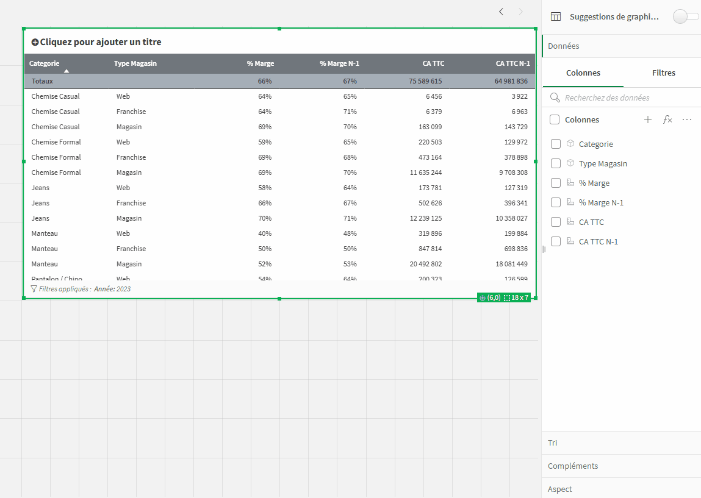
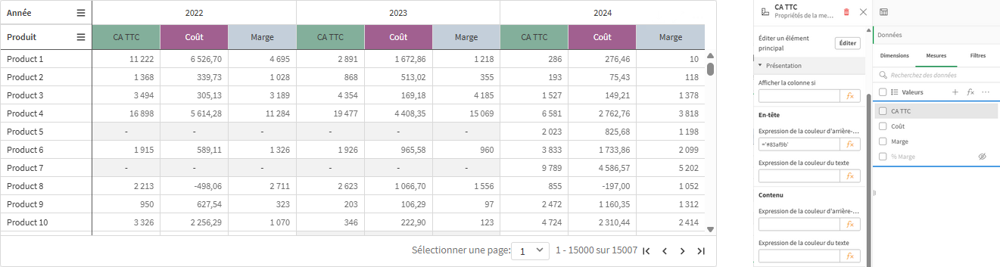
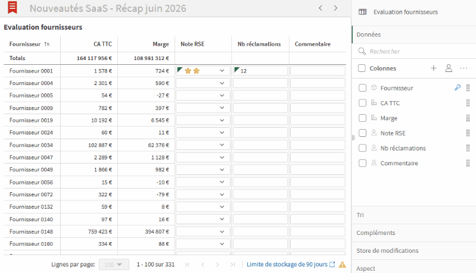
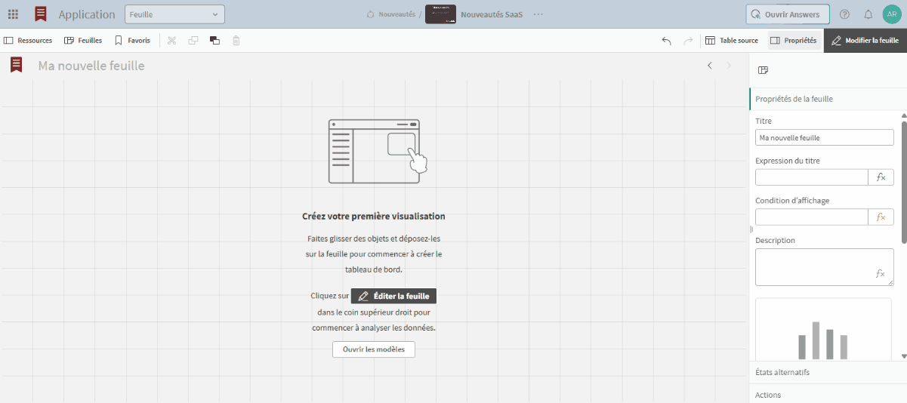
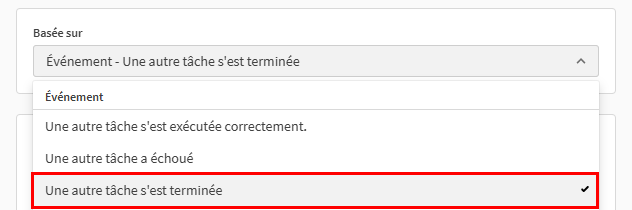
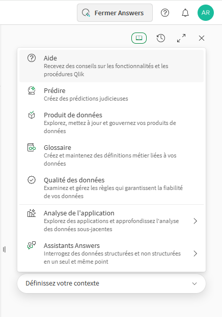
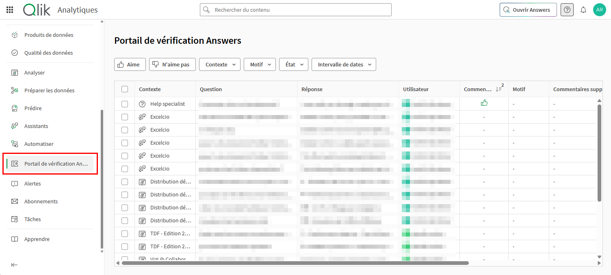
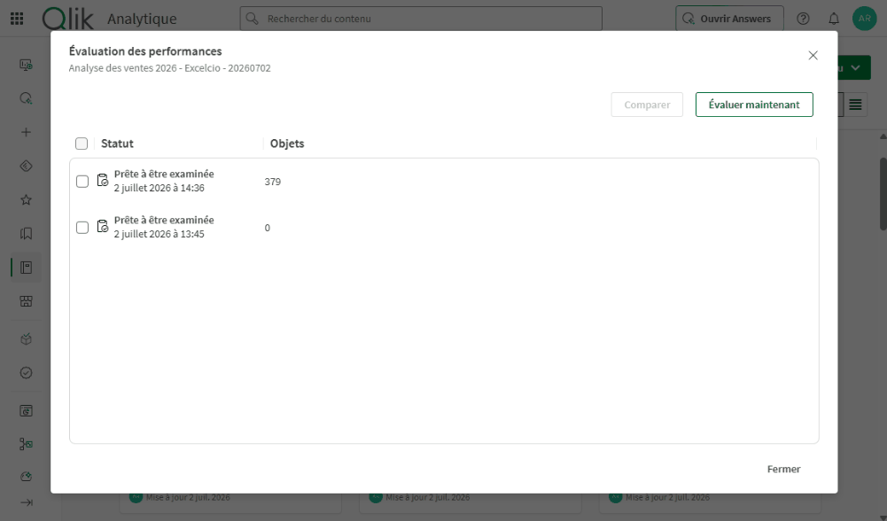

Voici les nouveautés Qlik Cloud de juin 2026.

## Sous-totaux dans le tableau simple

Il est désormais possible d’ajouter des sous-totaux sur les dimensions du tableau simple et d’en personnaliser le style.

## Couleurs dans le tableau croisé dynamique

Dans le tableau croisé dynamique (ancienne extension « Pivot table »), il est possible de personnaliser la couleur d’arrière-plan et de texte des en-têtes et du contenu de chaque colonne indépendamment à partir d’une expression. 

## Store de modifications des tables d’annotation

Il est désormais possible de nommer les stores de modifications et de connecter une table d’annotations à un store existant, afin de faciliter notamment les mises en production d’applications. 

## Création automatique d’objets « Texte » ou « Image » en copiant / collant

Lors de l’édition d’une feuille, le collage d’une image entraîne son ajout à la bibliothèque multimédia de l’application et la création d’un objet « Image ».
Quant au collage d’un texte, cela entraîne la création d’un objet « Texte » reprenant la plupart des mises en forme.

## Enchainement de tâches de rechargement

Une tâche peut désormais être exécuté dès qu’une autre tâche est terminée, peu importe son statut. 

## Qlik Answers

De **nouveaux contextes d’exécutions** sont disponibles dans Qlik Answers pour interagir en langage naturel avec de nouvelles briques :

- **Prédire** : créer des prédictions en s’appuyant sur Qlik Predict

- **Produit de données** : explorer et créer des produits de données

- **Glossaire** : explorer, créer et modifier des glossaires

- **Qualité de données** : examiner et gérer les règles

Un**portail de vérification** centralise l’ensemble des questions posées sur le tenant. A noter que son accès nécessite la création d’un rôle personnalisé et d’avoir les droits suffisants sur le contenu sur lequel a été posé la question.

On notera également une **amélioration de l’interrogation de données non structurées**, qui permet désormais de lister les fichiers indexés dans une base de connaissance et d’interroger un fichier en particulier.

## Recommandations d’amélioration des performances

L’outil d’amélioration des performances dispose d’un nouvel onglet « Recommandations » proposant des actions concrètes à mener, telles que :

- Liste des champs non utilisés à supprimer

- Ajout de condition de calcul sur certains graphiques

- Réduction de nombre de graphiques dans une feuille

- Déplacement d’une dimension calculée dans le graphique

- Jointure pour limiter les liens entre les tables

- Etc.

## Autres nouveautés :

- **Nouvel emplacement disponible au Canada**, ce qui porte à 14 le nombre d’emplacements disponibles : Etats-Unis, Europe (France, Irlande, Allemagne, Angleterre ou Suède), Asie-Pacifique (Singapour, Australie, Japon ou Inde), Moyen-Orient, Israël, Brésil et Canada.

- **Rattachement d’un glossaire à un produit de données** : en plus du texte libre et des contacts clés, il est possible d’ajouter un ou plusieurs glossaires à la section « Documentation » d’un produit de données.

- **Copier les visualisations surveillées** : possibilité de copier ou d’enregistrer en tant qu’images les visualisations surveillées depuis le centre d’activités.

- **Filtre sur les objets dans les rapports** : permet d’application un filtre à un objet spécifique d’un rapport d’application (Excel, Word, PowerPoint, HTML ou PixelPerfect).

Pour aller plus loin, retrouvez la présentation des nouveautés des précédentes versions :

Qlik Cloud 2026

- [Qlik Cloud Janvier 2026](/actualites/qlik-cloud-janvier-2026/)
- [Qlik Cloud Février 2026](/actualites/qlik-cloud-fevrier-2026/)
- [Qlik Cloud Mars 2026](/actualites/qlik-cloud-mars-2026/)
- [Qlik Cloud Avril 2026](/actualites/qlik-cloud-avril-2026/)
- [Qlik Cloud Mai 2026](/actualites/qlik-cloud-mai-2026/)
- [Qlik Cloud Juin 2026](/actualites/qlik-cloud-juin-2026/)

Qlik Cloud 2025

- [Qlik Cloud Janvier 2025](https://excelcio.com/2025/02/17/qlik-sense-saas-janvier-2025/)
- [Qlik Cloud Février 2025](https://excelcio.com/2025/03/25/qlik-sense-saas-fevrier-2025/)
- [Qlik Cloud Mars 2025](https://excelcio.com/2025/04/10/qlik-sense-saas-mars-2025/)
- [Qlik Cloud Avril 2025](https://excelcio.com/2025/05/16/qlik-sense-saas-avril-2025/)
- [Qlik Cloud Mai 2025](https://excelcio.com/2025/06/03/qlik-sense-saas-mai-2025/)
- [Qlik Cloud Juin 2025](https://excelcio.com/2025/07/10/qlik-sense-saas-juin-2025/)
- [Qlik Cloud Juillet et Août 2025](https://excelcio.com/2025/09/16/qlik-sense-saas-ete-2025/)
- [Qlik Cloud Septembre 2025](/actualites/qlik-sense-saas-sept-2025/)
- [Qlik Cloud Octobre 2025](/actualites/qlik-sense-saas-octobre-2025/)
- [Qlik Cloud Novembre 2025](/actualites/qlik-sense-saas-novembre-2025/)
- [Qlik Cloud Décembre 2025](/actualites/qlik-sense-saas-decembre-2025/)

Qlik Cloud 2024

- [Qlik Cloud Janvier 2024](https://excelcio.com/2024/02/14/qlik-sense-saas-janvier-2024-le-recap/)
- [Qlik Cloud Février 2024](https://excelcio.com/2024/03/07/qlik-sense-saas-fevrier-2024-le-recap/)
- [Qlik Cloud Mars 2024](https://excelcio.com/2024/04/22/qlik-sense-saas-mars-2024-le-recap/)
- [Qlik Cloud Avril 2024](https://excelcio.com/2024/06/14/qlik-sense-saas-avril-2024-le-recap/)
- [Qlik Cloud Mai 2024](https://excelcio.com/2024/06/14/qlik-sense-saas-mai-2024-le-recap/)
- [Qlik Cloud Juin 2024](https://excelcio.com/2024/07/22/qlik-sense-saas-juin-2024-le-recap/)
- [Qlik Cloud Juillet et Août 2024](https://excelcio.com/2024/07/22/qlik-sense-saas-juin-2024-le-recap/)
- [Qlik Cloud Septembre 2024](https://excelcio.com/2024/10/10/qlik-sense-saas-septembre-2024/)
- [Qlik Cloud Octobre 2024](https://excelcio.com/2024/11/25/qlik-sense-saas-octobre-2024/)
- [Qlik Cloud Novembre 2024](https://excelcio.com/2025/01/13/qlik-sense-saas-novembre-2024/)
- [Qlik Cloud Décembre 2024](https://excelcio.com/2025/02/14/qlik-sense-saas-decembre-2024/)

Qlik Cloud 2023

- [Qlik Cloud Janvier 2023](https://excelcio.com/2023/02/10/qlik-sense-saas-janvier-2023/)
- [Qlik Cloud Février 2023](https://excelcio.com/2023/03/10/qlik-sense-saas-fevrier-2023/)
- [Qlik Cloud Mars 2023](https://excelcio.com/2023/04/06/qlik-sense-saas-mars-2023/)
- [Qlik Cloud Avril 2023](http://excelcio.com/2023/06/05/qlik-sense-saas-avril-2023/)
- [Qlik Cloud Mai 2023](https://excelcio.com/2023/06/05/qlik-sense-saas-mai-2023/)
- [Qlik Cloud Juin 2023](https://excelcio.com/2023/07/13/qlik-sense-saas-juin-2023-le-recap/)
- [Qlik Cloud Juillet et Août 2023](https://excelcio.com/2023/09/18/qlik-sense-saas-ete-2023-le-recap/)
- [Qlik Cloud Septembre 2023](https://excelcio.com/2023/10/20/qlik-sense-saas-septembre-2023-le-recap/)
- [Qlik Cloud Octobre 2023](https://excelcio.com/2023/11/28/qlik-sense-saas-octobre-2023-le-recap/)
- [Qlik Cloud Novembre 2023](https://excelcio.com/2023/12/11/qlik-sense-saas-novembre-2023-le-recap/)
- [Qlik Cloud Décembre 2023](https://excelcio.com/2024/01/08/qlik-sense-saas-decembre-2023-le-recap/)

Qlik Cloud 2022

- [Qlik Cloud Février 2022](https://excelcio.com/2022/03/07/qlik-sense-saas-fevrier-2022/)
- [Qlik Cloud Mars 2022](https://excelcio.com/2022/04/07/qlik-sense-saas-mars-2022)
- [Qlik Cloud Avril 2022](https://excelcio.com/2022/05/12/qlik-sense-saas-avril-2022)
- [Qlik Cloud Mai 2022](https://excelcio.com/2022/06/07/qlik-sense-saas-mai-2022)
- [Qlik Cloud Juin 2022](https://excelcio.com/2022/07/22/qlik-sense-saas-juin-2022)
- [Qlik Cloud Juillet 2022](https://excelcio.com/2022/08/23/qlik-sense-saas-juillet-2022)
- [Qlik Cloud Août 2022](https://excelcio.com/2022/09/13/qlik-sense-saas-aout-2022)
- [Qlik Cloud Septembre 2022](https://excelcio.com/2022/10/20/qlik-sense-saas-septembre-2022/)
- [Qlik Cloud Octobre 2022](https://excelcio.com/2022/11/10/qlik-sense-saas-octobre-2022)
- [Qlik Cloud Novembre 2022](https://excelcio.com/2022/11/30/qlik-sense-saas-novembre-2022)
- [Qlik Cloud Décembre 2022](https://excelcio.com/2023/01/11/qlik-sense-saas-decembre-2022/)

Pour continuer à **[tirer le meilleur de Qlik Cloud,](https://excelcio.com/2023/05/02/qlik-sense-saas/)** retrouvez des vidéos vous présentants :

- trois fonctionnalités qui vont vous permettre de surveiller vos données,

- différents cas d’usages des notes collaboratives,

- l’analyse d’impact et traçabilité de vos données.

### Vous souhaitez monter en compétences sur Qlik Cloud ?

[Découvrez nos formations Qlik Cloud](/formations/)
